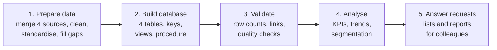

# LUMS Alumni Analytics – SQL Project

An end-to-end data analyst project on the LUMS alumni database: from combining and
cleaning raw files, through designing and loading a relational database on
**Azure SQL Database**, to validating the data and answering real business requests
with **T-SQL**.

I manage the alumni database (44,000+ records) in the Office of Advancement and turn
**data requests from departments across LUMS into accurate, verified lists every day**:
American Business Forum (ABF)–LUMS events, international delegations (Japan, France, and
others), the New York, UK and Canada reunions, the LUMS at 40 Gala in New York, the
smart card and the alumni portal. This repository uses a
practice set of **22,794 records**.

> **No personal data is stored in this repository.** It holds SQL code, table
> structure and documentation only.

## Workflow

| Step | Folder | What's inside |
|---|---|---|
| 1. Prepare data | [`01_data_preparation/`](01_data_preparation/) | How 4 sources were merged on Campus ID, cleaned and standardised, and how gaps were filled from LinkedIn without overwriting data |
| 2. Build database | [`02_database_setup/`](02_database_setup/) | `CREATE TABLE` with primary/foreign keys, loading approach, reporting views, a parameterised stored procedure |
| 3. Validate | [`03_data_validation/`](03_data_validation/) | Schema check, row counts and referential checks, completeness, duplicates, source conflicts |
| 4. Analyse | [`04_analysis/`](04_analysis/) | KPI summary, year-on-year trends, running totals, age bands, top employers per school, healthcare alumni |
| 5. Answer requests | [`05_work_requests/`](05_work_requests/) | 7 production queries – each file states the business question, approach, validation and output |
| Continuous learning | [`06_learning_log/`](06_learning_log/) | Deliberate T-SQL practice alongside daily work, with the lesson from each session recorded |
| Reference | [`docs/`](docs/) | [Data model](docs/data_model.md), [data dictionary](docs/data_dictionary.md) and the diagram code |

## Data model

Four tables linked by `roll_number`:

| Table | Rows | Relationship to `alumni` |
|---|---|---|
| `alumni` | 22,794 | – |
| `education` | 22,794 | exactly one per person |
| `contact` | 22,794 | exactly one per person |
| `employment` | 20,196 | zero or one per person → use `LEFT JOIN` for all alumni |

## Data requests answered (7 queries)

Seven production queries, a sample of the everyday data requests I receive. Every output is
validated before delivery: duplicates removed, deceased alumni excluded, totals reconciled and
low-confidence matches flagged for review. Queries 05–07 were delivered on a single, ordinary day.

| # | Business question | Approach | Output |
|---|---|---|---|
| [01](05_work_requests/01_top3_senior_alumni_per_batch.sql) | Rank the 3 most senior alumni in each graduating cohort, for an alumni event | Rule-based seniority scoring (`CASE`) and window ranking (`ROW_NUMBER` per cohort) | 63 alumni across 21 cohorts |
| [02](05_work_requests/02_alumni_list_1995_2006.sql) | Extract the 1995–2006 cohorts for an admissions email campaign | Cohort filter with de-duplication of dual-degree records | 2,221 records; 39 dual-degree duplicates flagged |
| [03](05_work_requests/03_match_contact_list_to_alumni.sql) | Match an external contact list to the alumni database | Record linkage on email and phone, with name as a flagged fallback | 7 of 12 matched (6 exact, 1 by name) |
| [04](05_work_requests/04_uk_healthcare_alumni.sql) | Identify alumni working in UK healthcare, including the NHS | Segmentation by industry and employer, with a geographic filter | 31 alumni (19 healthcare, 12 pharma and life sciences) |
| [05](05_work_requests/05_city_visit_alumni_list.sql) | Geo-segment alumni in Sialkot and Faisalabad for a team visit | Location matching across four fields, with a confidence label per record | 567 alumni; 221 with a high-confidence current location |
| [06](05_work_requests/06_match_external_list_roll_or_name.sql) | Enrich 163 scholarship recipients with employment and higher-education data | Record linkage: ID first, then a unique-name fallback (`OUTER APPLY`) | 148 of 163 matched (140 by ID, 8 by name, flagged) |
| [07](05_work_requests/07_award_winners_for_qs_rankings.sql) | Compile Alumni Achievement Award winners for the QS Rankings submission | External list matched on name and cohort year, returned in the requester's schema | 64 of 66 winners matched |

## Selected findings
- **Job data completeness** varies by program: only 3.5% of MBA alumni have no job record, versus about 25% of MSc and PhD alumni – a clear target for the next data-update campaign.
- **SBASSE sends the highest share of alumni abroad (42%)**, while MGSHSS has the most alumni abroad in absolute numbers (2,779).
- Graduating classes dipped in 2020 (−73) and jumped in 2021 (+258), consistent with delayed graduations.

## Quality practices
- Test filters against real values before trusting them – e.g. `LIKE '%Wales%'` also matched *New South Wales*, and the industry value is `Medical Device` (singular).
- Reconcile totals and state exclusions (e.g. *"excludes 5 undeclared programs and 1,323 records with no gender"*).
- Never overwrite existing data when filling gaps; keep a change log.
- Exclude deceased alumni from all outreach lists; never export national ID numbers.

## Skills
`JOIN` (INNER / LEFT / anti-join) · `GROUP BY` / `HAVING` · `CASE` · `COALESCE` · `LIKE` patterns ·
CTEs · window functions (`ROW_NUMBER`, `DENSE_RANK`, `LAG`, running totals) · `OUTER APPLY` · date functions ·
views · stored procedures · `INFORMATION_SCHEMA` · data validation · data cleaning · GDPR-conscious reporting

**Tools:** Azure SQL Database (T-SQL) · Excel · CRM · Power BI · Python · Git / GitHub

## Continuous learning
I started learning SQL in June 2026 and keep building on it alongside the day-to-day requests above. Each practice file below revisits one stage on this database (written in November 2026) and records what it taught me.

| Learned | Session | Topics |
|---|---|---|
| Jun–Jul 2026 | [Session 1 – basics](06_learning_log/session1_basics.sql) | COUNT, WHERE, BETWEEN, HAVING, first JOIN |
| Aug–Sep 2026 | [Session 2 – GROUP BY](06_learning_log/session2_group_by.sql) | GROUP BY, HAVING, TOP vs LIMIT |
| Sep–Oct 2026 | [Session 3 – JOINs](06_learning_log/session3_joins.sql) | INNER vs LEFT JOIN, anti-join, NOT EXISTS, 3-table joins |
| Oct–Nov 2026 | [Session 4 – JOIN + CASE](06_learning_log/session4_joins_and_case.sql) | CASE labels, CTEs, SUM(CASE) pivots |
