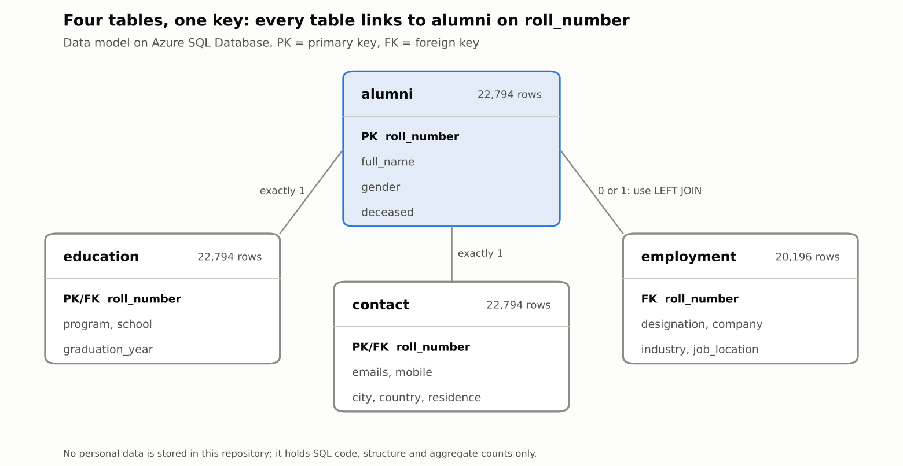
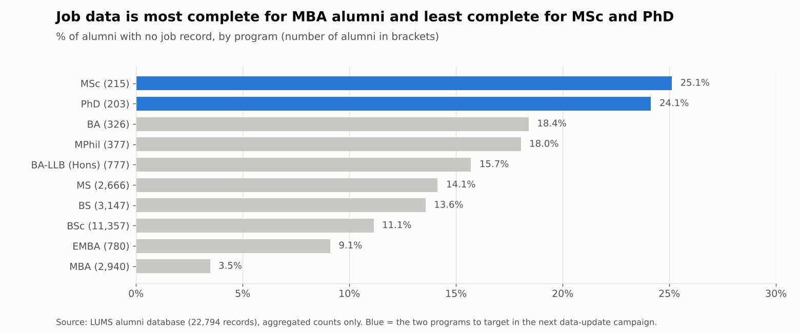
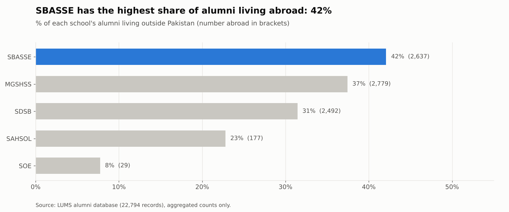
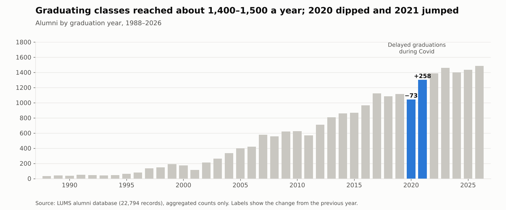

# LUMS Alumni Analytics – SQL Project

An end-to-end data analyst project on a real alumni database of **22,794 records**:
from combining and cleaning raw files, through designing and loading a relational
database on **Azure SQL Database**, to validating the data and answering real
business requests with **T-SQL**.

**Headline:** a working Azure SQL database built from four messy sources, validated, and used to answer **8 real requests from colleagues**, from senior-alumni lists for events to the awards list for the QS rankings submission.

> **No personal data is stored in this repository.** It holds SQL code, table
> structure and documentation only.

## Workflow

**Prepare data → Build database → Validate → Analyse → Answer requests**

| Step | Folder | What's inside |
|---|---|---|
| 1. Prepare data | [`01_data_preparation/`](01_data_preparation/) | How 4 sources were merged on Campus ID, cleaned and standardised, and how gaps were filled from LinkedIn without overwriting data |
| 2. Build database | [`02_database_setup/`](02_database_setup/) | `CREATE TABLE` with primary/foreign keys, loading approach, reporting views, a parameterised stored procedure |
| 3. Validate | [`03_data_validation/`](03_data_validation/) | Schema check, row counts and referential checks, completeness, duplicates, source conflicts |
| 4. Analyse | [`04_analysis/`](04_analysis/) | KPI summary, year-on-year trends, running totals, age bands, top employers per school, healthcare alumni |
| 5. Answer requests | [`05_work_requests/`](05_work_requests/) | Real requests from colleagues – each file states the request, approach, quality checks and result |
| Continuous learning | [`06_learning_log/`](06_learning_log/) | Deliberate T-SQL practice alongside daily work, with the lesson from each session recorded |
| Reference | [`docs/`](docs/), [`charts/`](charts/) | [Data model](docs/data_model.md), [data dictionary](docs/data_dictionary.md), and the code for the charts in this README |

## Data model

Four tables linked by `roll_number`:

| Table | Rows | Relationship to `alumni` |
|---|---|---|
| `alumni` | 22,794 | – |
| `education` | 22,794 | exactly one per person |
| `contact` | 22,794 | exactly one per person |
| `employment` | 20,196 | zero or one per person → use `LEFT JOIN` for all alumni |

## Real requests answered

| # | Request | Result |
|---|---|---|
| 01–02 | Top 3 most senior alumni in each graduating batch, for an alumni event | 63 alumni across 21 batches |
| 03 | Alumni from the 1995–2006 batches, for an admissions email campaign | 2,221 alumni delivered; 39 two-degree duplicates flagged |
| 04 | Match an external contact list against the alumni database | 7 of 12 matched (6 by email/phone, 1 by name, flagged) |
| 05 | Alumni currently working in UK healthcare, including the NHS | 31 alumni (19 healthcare, 12 pharma & life sciences) |
| 06 | Alumni contacts in Sialkot and Faisalabad for a team visit | 567 alumni; 221 confirmed in the city now, the rest flagged as hometown only |
| 07 | Employment and higher education for 163 scholarship recipients from an external Excel list | 148 matched (140 by roll number, 8 by name, flagged for checking) |
| 08 | Alumni Achievement Award winners for the QS Rankings submission | 64 of 66 winners matched and returned in the requester's template |

## Selected findings

### Job data is least complete for MSc and PhD alumni
Only 3.5% of MBA alumni have no job record, against about 25% of MSc and PhD alumni: a clear target for the next data-update campaign. Query: [`03_job_data_completeness_by_program.sql`](03_data_validation/03_job_data_completeness_by_program.sql).

### SBASSE has the highest share of alumni abroad
42% of SBASSE alumni live outside Pakistan. MGSHSS has the most alumni abroad in absolute numbers (2,779). Query: [`01_kpi_reporting.sql`](04_analysis/01_kpi_reporting.sql).

### Graduating classes dipped in 2020 and jumped in 2021
Classes fell by 73 in 2020 and rose by 258 in 2021, consistent with graduations delayed by Covid.

Charts are drawn by [`charts/make_charts.py`](charts/make_charts.py) from aggregate counts in `charts/data/` (no personal data).

## Quality practices
- Test filters against real values before trusting them – e.g. `LIKE '%Wales%'` also matched *New South Wales*, and the industry value is `Medical Device` (singular).
- Reconcile totals and state exclusions (e.g. *"excludes 5 undeclared programs and 1,323 records with no gender"*).
- Never overwrite existing data when filling gaps; keep a change log.
- Exclude deceased alumni from all outreach lists; never export national ID numbers.

## Skills
`JOIN` (INNER / LEFT / anti-join) · `GROUP BY` / `HAVING` · `CASE` · `COALESCE` · `LIKE` patterns ·
CTEs · window functions (`ROW_NUMBER`, `DENSE_RANK`, `LAG`, running totals) · date functions ·
views · stored procedures · `INFORMATION_SCHEMA` · data validation · data cleaning · GDPR-conscious reporting

**Tools:** Azure SQL Database (T-SQL) · Excel · Python · Git / GitHub

## Continuous learning
Alongside the day-to-day requests above, I run short, deliberate practice sessions to sharpen specific T-SQL techniques and record what each one taught me. This is how I keep improving, and how the techniques in the work requests were built up.

| Date | Session | Topics |
|---|---|---|
| 2026-11-14 | [Session 1 – basics](06_learning_log/2026-11-14_session1_basics.sql) | COUNT, WHERE, BETWEEN, HAVING, first JOIN |
| 2026-11-16 | [Session 2 – GROUP BY](06_learning_log/2026-11-16_session2_group_by.sql) | GROUP BY, HAVING, TOP vs LIMIT |
| 2026-11-17 | [Session 3 – JOINs](06_learning_log/2026-11-17_session3_joins.sql) | INNER vs LEFT JOIN, anti-join, NOT EXISTS, 3-table joins |
| 2026-11-17 | [Session 4 – JOIN + CASE](06_learning_log/2026-11-17_session4_joins_and_case.sql) | CASE labels, CTEs, SUM(CASE) pivots |
