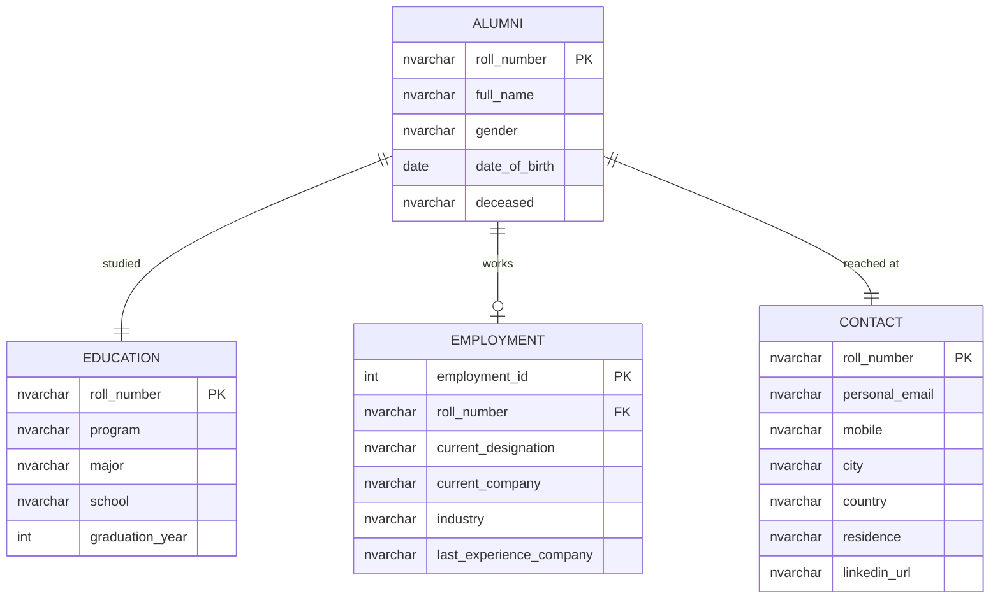

# Data model

Four tables, all linked by `roll_number` (one person = one roll number).

| Table | Rows | Relationship to `alumni` | Join to use |
|---|---|---|---|
| `alumni` | 22,794 | – | – |
| `education` | 22,794 | exactly 1 per person | `INNER JOIN` |
| `contact` | 22,794 | exactly 1 per person | `INNER JOIN` |
| `employment` | 20,196 | 0 or 1 per person | `LEFT JOIN` when you need **all** alumni |

**Which table?**
- name, gender, date of birth → `alumni`
- program, major, school, graduation year → `education`
- company, job title, industry → `employment`
- email, phone, city, country, LinkedIn → `contact`
